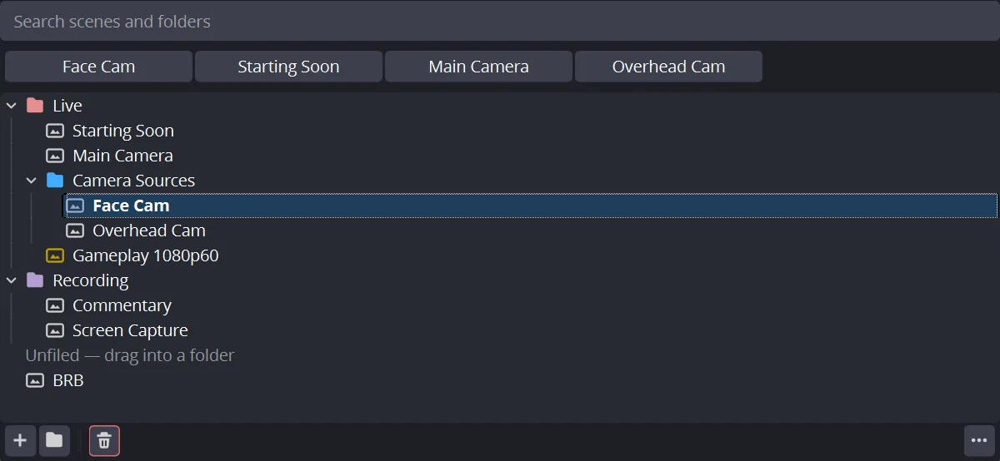

# SceneAnchor

> Folder tree for the OBS scene list — the folders live inside the scene collection, so copying or renaming it never loses them.

[](LICENSE) [](https://github.com/rockbenben/365opensource)

[⬇ Download for Windows / macOS / Linux](https://github.com/rockbenben/scene-anchor/releases) · [OBS Forum](https://obsproject.com/forum/resources/sceneanchor.2666/) · [简体中文](README.zh.md)



**Scene folders that stay put.** Existing scene-tree plugins keep their folders in a side file keyed by collection name, so copying or renaming a collection loses the lot. SceneAnchor writes the tree into the scene collection's own JSON — the same file as the scenes — so it survives copies, renames, exports, OBS updates, and uninstalling the plugin.

## Supported

| Item | Detail |
|---|---|
| OBS Studio | 33.0 and newer (tested on 33.0.1) |
| Platform | Windows x64 — developed and tested here. macOS 13+ (Universal) and Ubuntu 26.04 x86_64 build and package in CI but have not been run on real hardware; see Limitations |
| Scenes | Main canvas only — see Limitations |
| Interface | 12 languages, follows OBS's own language setting |
| Install | Windows `.exe` installer or `.zip` · macOS `.pkg` installer (unsigned, see Install) · Linux `.deb` |

## Features

- **Folder tree** with unlimited nesting for organizing scenes
- **Multi-select drag & drop** to move scenes and folders around, with proper OBS-native undo/redo
- **Live search** that filters the tree as you type — press **Enter** to transition to the first switchable match (folder rows and anything collapsed out of view are skipped, because the walk follows what is actually on screen; in Studio Mode it sets the preview, like every other switch in this dock), **Esc** to clear. Bind a hotkey (Settings → Hotkeys → *SceneAnchor: focus the search box*) and the whole flow is keyboard-only: hotkey, two characters, Enter.
- **Color labels** on folders and scenes — 8 presets plus any custom color, automatically adjusted to stay readable on your theme (see below)
- **MRU strip** of recently-used scenes, one click to switch; how many fit is computed from the dock's width, so names stay readable instead of being chopped to stubs
- **Empty-state guidance**: with no folders yet the dock looks exactly like OBS's own scene list — right down to the left edge, since the expander column is only reserved once a folder exists — so it says how to make the first one; the hint disappears once you do, while a search filter is active, and also whenever the dock is too small to show it whole (a hint cut off mid-sentence reads as a bug)
- **Options** under the ⋯ button at the dock's right end (or right-clicking empty tree space): double-click action (transition / rename / none), whether clicking or arrowing onto a scene switches to it, whether to show the MRU strip, whether to show icons (one switch covering folders and scenes alike, the way OBS's own source list does it)
- **Full right-click menu**: transition to scene, rename (F2), duplicate, remove, a **Filters** submenu (copy / paste / open), a **Projector** submenu (window, or fullscreen per display — listed at the display's real pixel size), screenshot, transition override with its own duration, show in multiview, colour labels
- **Tree drawn to stay legible**: the expander chevron and the per-level indent guides are painted by the plugin rather than left to Qt's defaults, so they follow the active theme instead of vanishing on dark ones, and every folder carries a chevron — empty ones included, so a folder never reads as a scene
- **Narrow-dock friendly**: no minimum width forced on the dock; the recent-scenes row drops to one chip plus a ⋯ menu as you squeeze it
- **12 languages**: English, Simplified & Traditional Chinese, Spanish, Portuguese (BR), German, Japanese, Russian, French, Korean, Italian, Polish
- Uses only public OBS APIs — no private Qt slots, no `findChild`, no `QMetaObject::invokeMethod` on the main window

### About the color labels

Colors are stored exactly as you pick them, but drawn against the tree's *actual* background: before rendering, the label's HSL lightness is nudged until it clears the WCAG 3:1 contrast floor for graphical elements. Hue and saturation are untouched.

This is why presets can be chosen for looks rather than for contrast, and why a custom colour that would be invisible on your theme (a near-black blue on a dark theme, say) still shows up. One stored value stays correct on light and dark themes alike — no per-theme palette, so the same scene collection never renders different colours on different machines.

## Why another scene tree plugin

Existing scene-tree plugins ([DigitOtter/obs_scene_tree_view](https://github.com/DigitOtter/obs_scene_tree_view), [TheThirdRail/scene-tree-view](https://github.com/TheThirdRail/scene-tree-view)) are useful but have three recurring problems SceneAnchor was built to avoid:

1. **Your folders won't disappear** — the mechanism is in the opening paragraph above. Both linked projects' issue trackers carry reports of exactly the side-file failure it avoids.
2. **Public API only, so it won't silently break.** No private Qt slots, no `findChild`/`QMetaObject::invokeMethod`/`property()` calls into the OBS main window. Plugins that reach into private UI internals tend to break across OBS releases without warning.
3. **Organize, search, and switch — all in one dock.** Nested folders, color labels, and live search together, so you don't need a second plugin just to find a scene in a long list.

## Install

Grab your platform's file from [Releases](https://github.com/rockbenben/scene-anchor/releases): **Windows** an `.exe` installer (or a `.zip`), **macOS** a `.pkg` installer, **Linux** a `.deb` (`sudo apt install ./scene-anchor-*.deb`).

**This branch targets OBS 33+.** The latest published release is still 1.0.1 (OBS 32); the next release, 2.0.0, moves to OBS 33's plugin layout. OBS 32 users should stay on 1.0.1.

**Windows: run the `.exe` and you're done.** It defaults to `C:\ProgramData\obs-studio\plugins\` — the machine-wide plugin directory OBS 33 reads for a normal install, and the one an OBS update won't wipe. For a **portable** OBS, point the installer at the folder containing `bin\64bit\obs64.exe`; it will install to `<OBS>\plugins\scene-anchor\` instead. The two layouts are chosen from the folder you pick, and switching between them removes the old copy so OBS never loads the plugin twice. Both targets are machine-wide, so it asks for administrator rights once. It shows up under Settings → Apps if you ever want it gone. The installer is not code-signed, so Windows SmartScreen will say *"Windows protected your PC"* — click **More info → Run anyway**.

**Windows by hand (the `.zip`).** Unzip it and move the whole `scene-anchor` folder into `C:\ProgramData\obs-studio\plugins\` — keep the folder together, the archive is already in the layout OBS 33 expects. Paste `%ProgramData%\obs-studio\plugins` into the Explorer address bar to get there, creating the `plugins` folder if it isn't there yet. The result is what the installer would have produced:

```
C:\ProgramData\obs-studio\plugins\scene-anchor\scene-anchor.dll
C:\ProgramData\obs-studio\plugins\scene-anchor\data\locale\en-US.ini
```

Note it is `ProgramData`, not `%APPDATA%` — OBS reads plugins from the machine-wide directory on Windows, and a copy under `AppData\Roaming` is silently never loaded.

**Inside a portable OBS folder instead.** Unzip the archive into `<OBS>\plugins\` so the result is `<OBS>\plugins\scene-anchor\scene-anchor.dll` plus `<OBS>\plugins\scene-anchor\data\...` — where `<OBS>` is the folder containing `bin\64bit\obs64.exe` and `portable_mode.txt`. A normal (non-portable) OBS install must use ProgramData; `<OBS>\plugins` is only read in portable mode. The installer covers this case too — point it at `<OBS>` on its destination page.

Restart OBS after any of these.

**macOS: the installer is not signed.** Double-clicking the `.pkg` gets you *"cannot be opened because it is from an unidentified developer"* — right-click it and choose **Open** instead, or allow it under System Settings → Privacy & Security. This is about the installer, not the plugin: OBS ships `com.apple.security.cs.disable-library-validation` in its own entitlements (`frontend/cmake/macos/entitlements.plist`) precisely so it can load third-party plugins, so an unsigned plugin loads normally once installed. Signing the installer needs an Apple Developer ID, which most individual OBS plugin authors don't buy — [obs-move-transition](https://github.com/exeldro/obs-move-transition), [waveform](https://github.com/phandasm/waveform) and [obs-multi-rtmp](https://github.com/sorayuki/obs-multi-rtmp) all ship unsigned packages today.

**After installing, enable the dock.** SceneAnchor's dock is not visible by default — OBS does not automatically show new plugin docks. Open OBS's **Docks** menu (View → Docks on some platforms) and check **SceneAnchor** to make it appear. If you don't see the dock after installing, this is almost always the reason — the plugin has not failed to load.

## Limitations

- **Deleting a scene that is nested inside another scene** (i.e. used as a source within another scene): undo restores the deleted scene and its child sources, but does **not** restore its placement entry inside the parent scene that referenced it. OBS's own delete path handles this case with `scene_used_in_other_scenes` + `RemoveSceneAndReleaseNested`; SceneAnchor does not implement an equivalent. This is an accepted, documented gap, not an oversight.
- **Main canvas only.** Scenes belonging to a secondary canvas — a vertical canvas from Aitum Vertical, or any canvas another plugin creates with `obs_frontend_add_canvas` — do not appear in this dock at all. They are switched in that canvas's own dock, which is also where they belong.

  This is a decision, not a missing feature. OBS 33 still has no API for setting a secondary canvas's current scene: the frontend surface is `get_canvases` / `add_canvas` / `remove_canvas` and nothing more. The one function that looks generic, `obs_canvas_set_channel(canvas, 0, scene)`, is never called by OBS's own frontend — libobs uses it only inside `obs_set_output_source`, for the main canvas — and plugins that own a canvas typically keep a *transition* source in channel 0, not a scene. Writing a scene there would evict the transition, hard-cut the picture, and leave that plugin's idea of its current scene out of sync with what is on screen. A "generic" implementation would be active breakage.

  Individual plugins do expose their own switching hooks (Aitum Vertical ≥1.6.1 registers `aitum_vertical_switch_scene` on the global proc handler). Supporting one vendor and not the next is neither fair nor maintainable, and a scene this dock cannot switch to earns only two of its three verbs — find, organize, switch. Two is not enough to justify a section of the UI.
- **Toggling "Show in multiview" does not refresh a currently-open multiview projector immediately.** The change takes effect the next time the tree rebuilds (there is no public API to force a multiview refresh).
- **Drag-and-drop and creating scenes or folders are disabled while a search filter is active**, since the filter hides some items and a drop position could no longer match what's visually shown, while a new item may not match the active search at all. Clear the search box to re-enable dragging and creating.

- **Clicking a scene — or moving the selection with the arrow keys — switches to it, by default.** Right-clicking opens the scene menu without switching, and starting a drag does not switch either: the switch happens when a plain left click is released, so organising while live is safe as long as you use the context menu or drag rather than click. Arrow-keying past eight scenes to reach a folder is eight live program switches. Turn off **Click / Arrow Keys Switch Scene** in the ⋯ menu while you reorganize; the menu's **Transition to Scene**, double-click and the MRU chips still switch.
- **Changing a default in a new build does not reach existing users.** OBS persists plugin settings on exit, so once the plugin has run once, the stored value wins over any default the code declares. Defaults only apply to a fresh install.

**Gray areas**: transition override is stored under the `"transition"` / `"transition_duration"` private-settings keys, and multiview visibility under `"show_in_multiview"`. These keys are accessible through public API calls, but the keys themselves are an OBS frontend convention rather than a documented API contract — a future OBS version could change them without notice.

- **Only Windows has been exercised on real hardware.** The full manual checklist in [`docs/pre-release-checklist.md`](docs/pre-release-checklist.md) — drag, undo/redo, delete-undo, themes, localisation — was run on Windows against OBS 32.2.2. The OBS 33.0.x build has been exercised for load/dock/search/switch, MRU ordering, the click-delay modes, collection copy/switch/rename + force-kill, the hotkey/search flow and a clean shutdown log; the remaining items have not been rerun on OBS 33. The macOS and Linux targets compile and package in CI, and the plugin uses no platform-specific code, but nobody has yet launched OBS with it on either. Treat those two as untested rather than broken, and please report what you find.

## Reporting bugs

Bugs go to [GitHub Issues](https://github.com/rockbenben/scene-anchor/issues). Four things make a report actionable:

- **OBS version, platform, and plugin version.** The plugin prints the last one when it loads: `[scene-anchor] plugin loaded successfully (version 1.0.1)`.
- **The log from that session.** Help → Log Files → Upload Current Log File gives a shareable link; every line this plugin writes is prefixed `[scene-anchor]`.
- **What you did, what you expected, what happened** — and whether undo or redo was involved, because that is where this plugin's riskiest code paths are.
- **If folders went missing, attach the scene collection itself** (Scene Collection → Export Scene Collection). The tree is stored inside that file, so it is the evidence; a lost-folders report without it usually can't be diagnosed.

If OBS crashed rather than misbehaved, add the crash report too: Help → Crash Reports → Show Crash Reports.

## Translations

Every string lives in `data/locale/<lang>.ini`; the plugin ships 12 of the 77 locales OBS itself supports. OBS falls back to `en-US` for any key a locale is missing, so a partial file is safe to contribute.

Terminology is anchored to OBS's own locale files rather than translated freshly: *scene*, *rename*, *duplicate*, *filters*, *remove*, *transition*, *transition override*, *show in multiview*, *screenshot*, *custom color* and *fullscreen* all reuse the wording OBS already uses in that language, so the plugin reads as part of the host application. Menu items follow OBS's capitalisation too — Title Case in English (`Copy Filters`, `Show in Multiview`), sentence case wherever OBS itself uses it. Two words OBS has no term for — *folder* and *search* — use the platform-conventional word for each language.

Two deliberate divergences. **Dissolve folder** does not borrow OBS's *Ungroup* (`Basic.Main.Ungroup`) even though the operation is identical — a folder is not a group, and reusing the group vocabulary for it would suggest the two features are the same thing. Chinese *Duplicate* stays **创建副本** rather than OBS's 复制. OBS uses 复制 for both *Copy* and *Duplicate*, and this plugin's context menu contains 复制滤镜 (*Copy Filters*) a few rows away — anchoring here would create a real ambiguity rather than remove one.

**Only `en-US`, `zh-CN` and `zh-TW` have been checked by a speaker.** The other nine are term-anchored but unreviewed; corrections are welcome and are a one-line pull request. If you spot a wrong word, that file is the only thing you need to touch.

Keys must match `en-US` exactly — same key set, same `%1` placeholders, UTF-8 without BOM. Run `python tools/check-locales.py` after editing: it checks all of that plus duplicate keys, line endings, empty values, ellipsis consistency, strings long enough to be cut off in a narrow dock, whether the language is one OBS actually ships, and whether every key referenced by `obs_module_text` is defined and every defined key is used.

## Build

Requires the [obs-plugintemplate](https://github.com/obsproject/obs-plugintemplate) toolchain (CMake presets, `buildspec.json`-pinned obs-deps/Qt6). Only OBS Studio 33+ is supported.

**The pinned dependencies are the oldest supported target** (obs-studio 33.0.0, Qt 6.11.1 from obs-deps 2026-10-23), not the newest. Compiling against the 33.0.0 headers guarantees we only call APIs that exist across OBS 33.x, and Qt 6.11.1 is the Qt shipped with OBS 33.0, so the plugin loads on the OBS 33 runtime. Only raise the pins when the supported floor moves or a feature genuinely requires a newer API.

```bash
# Windows x64
cmake --preset windows-x64
cmake --build --preset windows-x64 --config RelWithDebInfo

# macOS
cmake --preset macos
cmake --build --preset macos --config RelWithDebInfo

# Ubuntu x86_64
cmake --preset ubuntu-x86_64
cmake --build --preset ubuntu-x86_64 --config RelWithDebInfo
```

Unit tests (no OBS runtime required; the tests link Qt only, with a fake OBS stub):

```bash
cmake -S tests -B build_tests -G Ninja
cmake --build build_tests
ctest --test-dir build_tests --output-on-failure
```

Real-time benchmark (not part of ctest): renders the dock against the fake OBS stub with 600 scenes and prints the average `rebuild` and scene-switch time. `BENCH_NO_MRU=1` and `BENCH_NO_ICONS=1` isolate the MRU strip and the icon work so a regression can be attributed:

```bash
cmake --build build_tests --target bench_dock
./build_tests/bench_dock
BENCH_NO_MRU=1 ./build_tests/bench_dock
```

## Design notes

[`docs/design.md`](docs/design.md) is the design spec: why the tree is stored inside the collection JSON, why nothing touches OBS's private Qt internals, how the undo model works, and which tradeoffs were made deliberately — including the ones this README only states as facts, such as the icons toggle covering folders and the chevron being painted rather than left to Qt. Source comments cite its sections (`spec §2`, `spec §4`) rather than repeating the reasoning.

[`docs/pre-release-checklist.md`](docs/pre-release-checklist.md) is the manual verification pass, with the measurements each item produced. Run it before shipping a binary — especially after touching the delete, undo or drag paths, which is where its only real defect was caught.

## About the 365 Open Source Plan

Project **#037** of the [365 Open Source Plan](https://github.com/rockbenben/365opensource) — one person + AI, 300+ open-source projects in a year.

[Submit your idea →](https://365.aishort.top/) · [Discord](https://discord.gg/PZTQfJ4GjX) · [Telegram](https://t.me/aishort_top)
