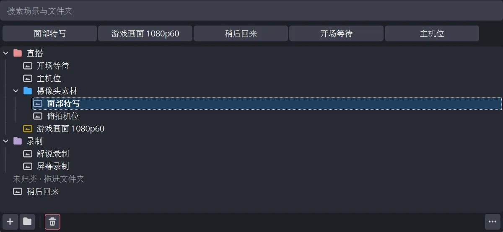

# SceneAnchor

> 给 OBS 场景列表加文件夹树——文件夹存在场景集合内部，复制或重命名集合都不会丢。

[](LICENSE) [](https://github.com/rockbenben/365opensource)

[⬇ 下载 Windows / macOS / Linux 版](https://github.com/rockbenben/scene-anchor/releases) · [OBS 论坛](https://obsproject.com/forum/resources/sceneanchor.2666/) · [English](README.md)



**文件夹放在哪就留在哪。** 现有的场景树插件把文件夹存在以集合名为键的侧车文件里，集合一旦复制或改名就全丢。SceneAnchor 把树写进场景集合自己的 JSON——和场景同一个文件——所以复制、改名、导出、升级 OBS，甚至卸载插件，文件夹都还在。

## 支持范围

| 项目 | 说明 |
|---|---|
| OBS Studio | 33.0 及以上（在 33.0.1 上实测） |
| 平台 | Windows x64——开发与实测都在这上面。macOS 13+（Universal）与 Ubuntu 26.04 x86_64 能在 CI 上编译打包，但从未在真机上跑起来过，见「已知限制」|
| 场景 | 仅主画布，副画布场景不进树，见「已知限制」 |
| 界面语言 | 12 种，跟随 OBS 自身的语言设置 |
| 安装 | Windows 用 `.exe` 安装包或 `.zip` · macOS 用 `.pkg` 安装包（未签名，见「安装」）· Linux 用 `.deb` |

## 能做什么

- **文件夹树**，无限层嵌套
- **多选拖拽**移动场景与文件夹，走 OBS 原生的撤销/重做
- **实时搜索**边打边过滤——按 **回车** 转场到第一个可切换的匹配项（跳过文件夹行和折叠隐藏的行，因为它走的是屏幕上实际可见的顺序；Studio 模式下设为预览，与本面板其他切换方式一致），**Esc** 清空。绑个热键（设置 → 热键 → *场景锚点：聚焦搜索框*）就是全键盘流程：热键、两个字、回车。
- **颜色标签**，文件夹和场景都能打——8 个预设加任意自定义色，渲染时自动调整以在你的主题下保持可读（见下）
- **最近使用条**，一键切回；能放几个由面板宽度算出来，宁可少放也不把名字截成残段
- **空状态引导**：还没有文件夹时，面板长得和 OBS 自带场景列表一模一样——连左边界都一样，因为展开箭头那一栏只在真有文件夹时才占位——于是它会说明怎么建第一个；建好就消失，面板小到放不下整句时也消失（截半句的引导读起来像坏了）
- **面板右下角「⋯」按钮的选项**（也可在树空白处右键）：双击行为（转场 / 重命名 / 无）、点击或用方向键是否切换场景、是否显示最近使用条、是否显示图标（一个开关同时管文件夹与场景，与 OBS 自己的来源列表同一套做法）
- **完整右键菜单**：转场到此场景、重命名（F2）、创建副本、删除、**滤镜**子菜单（复制 / 粘贴 / 打开）、**投影**子菜单（窗口，或按显示器全屏 — 报的是显示器真实像素尺寸）、截屏、覆盖转场动画（含时长）、在多视图中显示、颜色
- **画得清楚的树**：展开箭头与逐层缩进导引线由插件自绘而非交给 Qt 默认样式，因而跟随当前主题、不会在深色下消失；每个文件夹都有箭头，空文件夹也有，所以文件夹永远不会被读成场景
- **窄面板可用**：不给面板设人为下限；越拖越窄时，最近使用条会收成一枚按钮加一个「⋯」菜单
- **12 种语言**：英语、简体与繁体中文、西班牙语、葡萄牙语（巴西）、德语、日语、俄语、法语、韩语、意大利语、波兰语
- 只用公开的 OBS API——不碰私有 Qt 槽，不对主窗口调 `findChild` 或 `QMetaObject::invokeMethod`

### 关于颜色标签

颜色按你选的原样保存，但绘制时是对着树的**实际**背景来的：渲染前把标签的 HSL 明度往上或往下推，直到越过 WCAG 对图形元素规定的 3:1 对比度门槛。色相与饱和度不动。

所以预设可以按好看来挑，不必按对比度来挑；也所以一个在你主题下本该看不见的自定义色（比如深色主题上的近黑蓝）照样显示得出来。同一个存储值在深浅主题下都成立——没有分主题的调色板，同一个场景集合在不同机器上不会渲染出不同的颜色。

## 为什么再做一个场景树插件

现有的场景树插件（[DigitOtter/obs_scene_tree_view](https://github.com/DigitOtter/obs_scene_tree_view)、[TheThirdRail/scene-tree-view](https://github.com/TheThirdRail/scene-tree-view)）都好用，但有三个反复出现的问题是 SceneAnchor 一开始就要避开的：

1. **你的文件夹不会消失**——机制在开头那段。上面两个项目的 issue 里都有正是这种侧车文件失效的报告。
2. **只用公开 API，所以不会悄无声息地坏掉。** 不碰私有 Qt 槽，不对 OBS 主窗口调 `findChild`/`QMetaObject::invokeMethod`/`property()`。伸手进私有 UI 内部的插件，往往在 OBS 升级时毫无征兆地失效。
3. **整理、搜索、切换在同一个面板里完成。** 嵌套文件夹、颜色标签、实时搜索一起给，不必为了在长列表里找一个场景再装第二个插件。

## 安装

到 [Releases](https://github.com/rockbenben/scene-anchor/releases) 下载对应平台的文件：**Windows** 是 `.exe` 安装包（也提供 `.zip`）；**macOS** 是 `.pkg` 安装包；**Linux** 是 `.deb`（`sudo apt install ./scene-anchor-*.deb`）。

**2.0.0 只支持 OBS 33+。** OBS 32 用户请留在 1.0.1；这一版改用 OBS 33 的插件目录。

**Windows：双击 `.exe` 就装完了。** 默认装进 `C:\ProgramData\obs-studio\plugins\`——这是 OBS 33 在 Windows 上给常规安装读取的全机插件目录，也是 OBS 更新时不会被清掉的那个。**便携版**请在安装向导里把目标指向含 `bin\64bit\obs64.exe` 的 OBS 根目录，它会改装到 `<OBS>\plugins\scene-anchor\`。安装包按你选的目录挑布局，并在两者之间切换时清掉旧位置的副本，避免 OBS 把插件加载两次。两个目标都是全机范围的目录，所以会要一次管理员权限。想卸载在「设置 → 应用」里能找到。安装包未做代码签名，Windows SmartScreen 会拦一下（*「Windows 已保护你的电脑」*），点**详细信息 → 仍要运行**即可。

**Windows 手动装（`.zip`）：解压后把整个 `scene-anchor` 文件夹搬进 `C:\ProgramData\obs-studio\plugins\`。** 保持文件夹完整——压缩包里本来就是 OBS 33 认的目录结构。把 `%ProgramData%\obs-studio\plugins` 粘进资源管理器地址栏就能到，没有 `plugins` 目录就新建一个。结果跟安装包装出来的一样：

```
C:\ProgramData\obs-studio\plugins\scene-anchor\scene-anchor.dll
C:\ProgramData\obs-studio\plugins\scene-anchor\data\locale\zh-CN.ini
```

注意是 `ProgramData`，不是 `%APPDATA%`——Windows 上 OBS 只读全机范围的那个目录，放到 `AppData\Roaming` 下的副本会被静默忽略、永远不加载。

**装进便携版 OBS 目录：**把压缩包解到 `<OBS>\plugins\`，结果是 `<OBS>\plugins\scene-anchor\scene-anchor.dll` 加 `<OBS>\plugins\scene-anchor\data\...`。`<OBS>` 是含 `bin\64bit\obs64.exe` 和 `portable_mode.txt` 的根目录。常规（非便携）安装必须用 ProgramData；`<OBS>\plugins` 只在便携模式下读取。不想手动摆的话，安装包也覆盖这种情况——在选择目标位置那一页把路径指到 `<OBS>` 即可。

以上几种装法装完都要重启 OBS。

**macOS：安装包未签名。** 双击 `.pkg` 会看到*「无法打开，因为它来自身份不明的开发者」*——改成右键选**打开**，或到系统设置 → 隐私与安全性里放行。这是安装包的事，不是插件的事：OBS 自己的 entitlements 里带着 `com.apple.security.cs.disable-library-validation`（`frontend/cmake/macos/entitlements.plist`），正是为了能加载第三方插件，所以未签名的插件装好之后照常加载。给安装包签名需要 Apple Developer ID，多数独立 OBS 插件作者不会去买——[obs-move-transition](https://github.com/exeldro/obs-move-transition)、[waveform](https://github.com/phandasm/waveform)、[obs-multi-rtmp](https://github.com/sorayuki/obs-multi-rtmp) 至今发的都是未签名的包。

**Linux：先装 OBS 33。** Ubuntu 26.04 官方源里的 OBS 仍是 32.1，加载不了本插件。先按 [OBS PPA](https://launchpad.net/~obsproject/+archive/ubuntu/obs-studio) 装 OBS 33（`sudo add-apt-repository ppa:obsproject/obs-studio && sudo apt update && sudo apt install obs-studio`），再装 `.deb`。

**装好之后要手动打开面板。** SceneAnchor 的面板默认不可见——OBS 不会自动显示新插件的面板。打开 OBS 的**停靠部件**菜单（某些平台在 视图 → 停靠部件 下），勾选 **SceneAnchor** 就出来了。装完看不到面板，几乎都是这个原因，不是插件加载失败。

## 已知限制

- **删除一个被别的场景嵌套引用的场景**（即它被当作另一个场景里的一个来源）：撤销会恢复该场景及其子源，但**不会**恢复它在引用它的父场景中的摆放条目。OBS 自己的删除路径用 `scene_used_in_other_scenes` + `RemoveSceneAndReleaseNested` 处理这种情况，SceneAnchor 没有实现对应机制。这是写明并接受的缺口，不是疏漏。
- **只管主画布。** 属于副画布的场景——Aitum Vertical 的竖屏画布，或任何别的插件用 `obs_frontend_add_canvas` 建的画布——一概不出现在本面板里。它们在那个画布自己的面板里切换，那里也是它们该在的地方。

  这是一个决定，不是缺失的功能。OBS 33 仍然没有「设置某画布当前场景」的 API：frontend 层只有 `get_canvases` / `add_canvas` / `remove_canvas`，再无其他。唯一看着通用的 `obs_canvas_set_channel(canvas, 0, scene)`，OBS 自己的前端从不调用——libobs 只在 `obs_set_output_source` 内部用它，且只对主画布——而拥有画布的插件通常在 channel 0 上挂的是**转场源**而不是场景。往那里写场景会顶掉转场、画面硬切，并让那个插件记录的当前场景与屏幕上的实际画面失同步。所谓「通用实现」实为主动破坏。

  个别插件确实提供了自己的切换口子（Aitum Vertical ≥1.6.1 在全局 proc handler 上注册了 `aitum_vertical_switch_scene`）。支持这一家而不支持下一家既不公平也难维护；而一个本面板切不了的场景，只占得住三个动词里的两个——找到、整理、切换。两个不足以换一个 UI 分区。
- **切换「在多视图中显示」不会立刻刷新已打开的多视图投影。** 改动要等下一次树重建才生效（没有公开 API 能强制刷新多视图）。
- **搜索过滤生效期间禁用拖放**，因为过滤会隐藏一部分项，放置位置可能与看到的不符。清空搜索框即可恢复拖放。
- **默认「点击或方向键切换场景」**——包括用方向键移动选中项时。这与 OBS 自带场景列表一致，但那个列表只用来切换，而本面板还要用来拖拽、改名、上色。用方向键越过八个场景去够一个文件夹，就是八次真实的节目切换。整理的时候在「⋯」菜单里关掉**点击或方向键切换场景**；双击和菜单里的**转场到此场景**照常可用。
- **在新版本里改默认值不会影响老用户。** OBS 在退出时持久化插件设置，所以插件只要跑过一次，存下来的值就压过代码里声明的任何默认值。默认值只对全新安装生效。

**灰色地带**：转场覆盖存在 `"transition"` / `"transition_duration"` 这两个 private-settings 键下，多视图可见性存在 `"show_in_multiview"` 下。这些键可以通过公开 API 读写，但键名本身是 OBS 前端的约定而非有文档的 API 契约——未来某个 OBS 版本可能不打招呼就改掉。

- **只有 Windows 经过真机验证。**[`docs/pre-release-checklist.md`](docs/pre-release-checklist.md) 的人工检查已在 Windows 上对着 OBS 33.0.1 跑过第 1–8、10–13、15–20 项；第 9 项（副画布）没有对应插件，不适用。第 14 项（首次使用 dock 的可见性）已于 2026-10-31 在 OBS 33.0.0 的全新配置上补测通过。Windows 1.0.x → 2.0.0 升级已在 ProgramData 和便携版两种布局上验过；自定义色对话框也已实际点选通过。第 18 项（搜索热键）同日改用走系统输入队列的注入按键在 OBS 33.0.0 上重跑，抓到一个真缺陷并在本次构建里修掉：dock 处于浮动状态时，热键没有把键盘焦点送进搜索框。物理按键仍建议发版当天再按一次。macOS 与 Linux 目标能在 CI 上编译打包，插件本身也没有任何平台相关代码，但至今没有人在这两个系统上把 OBS 带着它启动过。请把它们当作**未验证**而不是**有问题**，遇到什么也欢迎报给我。

## 报告问题

问题请提到 [GitHub Issues](https://github.com/rockbenben/scene-anchor/issues)。四样东西决定一份报告能不能被查下去：

- **OBS 版本、平台，以及插件版本。**最后这项插件加载时会自己打进日志：`[scene-anchor] plugin loaded successfully (version 2.0.0)`。
- **那一次运行的日志。**帮助 → 日志文件 → 上传当前日志文件会生成一个可分享的链接；本插件写的每一行都带 `[scene-anchor]` 前缀。
- **你做了什么、预期什么、实际发生了什么**——以及是否涉及撤销或重做，那是本插件风险最高的代码路径。
- **如果文件夹丢了，把场景集合本身附上**（场景集合 → 导出场景集合）。树就存在那个文件里，它本身就是证据；缺了它的「文件夹丢失」报告基本无法定位。

如果是 OBS 崩溃而不是行为异常，再附上崩溃报告：帮助 → 错误报告 → 显示错误报告。

## 翻译

每一条文案都在 `data/locale/<语言>.ini` 里；插件提供 OBS 支持的 77 种 locale 中的 12 种。OBS 会为任何缺失的键回落到 `en-US`，所以只译一部分也是安全的。

术语锚定到 OBS 自己的 locale 文件而不是重新翻译：*场景*、*重命名*、*创建副本*、*滤镜*、*删除*、*转场*、*覆盖转场动画*、*在多视图中显示*、*截屏*、*自定义颜色*、*全屏* 全部沿用 OBS 在该语言里已有的说法，让插件读起来像宿主应用的一部分。菜单项的大小写也跟随 OBS——英文用 Title Case（`Copy Filters`、`Show in Multiview`），OBS 自己用句首大写的语言就跟着用。OBS 没有对应词的两个概念——*文件夹* 与 *搜索*——用各语言平台上的惯用词。

有两处刻意不锚定。**解散文件夹**不借用 OBS 的 *Ungroup*（`Basic.Main.Ungroup`），尽管动作完全相同——文件夹不是分组，借用分组的词汇会让人以为两者是同一个功能。中文的 *创建副本* 也不改成 OBS 的「复制」：OBS 自己用「复制」同时表示 Copy 和 Duplicate，而本插件同一个菜单里几行之外就有「复制滤镜」，跟着改是制造歧义而不是消除歧义。

**只有 `en-US`、`zh-CN`、`zh-TW` 经过母语者校对。** 另外九种是术语锚定但未经校对的；欢迎指正，一行 PR 就够。发现用词不对，要动的只有那一个文件。

键集必须与 `en-US` 完全一致——同一套键、同样的 `%1` 占位符、无 BOM 的 UTF-8。改完跑 `python tools/check-locales.py`：它会一次性查完上述各项，外加重复键、行尾、空值、省略号是否统一、在窄面板下会被截断的过长文案、该语言是否真的被 OBS 提供，以及 `obs_module_text` 引用的键是否都有定义、定义的键是否都被用到。

## 构建

需要 [obs-plugintemplate](https://github.com/obsproject/obs-plugintemplate) 工具链（CMake presets、由 `buildspec.json` 钉住的 obs-deps 与 Qt6）。只支持 OBS Studio 33+。

**钉住的依赖取支持范围里最旧的那一档**（obs-studio 33.0.0，Qt 6.11.1，来自 obs-deps 2026-10-23），不是最新的。对着 33.0.0 的头文件编译，才能保证只调用整个 OBS 33.x 都存在的 API；Qt 6.11.1 是 OBS 33.0 自带的 Qt，所以插件能在 OBS 33 的运行时里加载。除非支持范围移动或某个功能确实需要更新的 API，否则不要抬高这些钉子。

```bash
# Windows x64
cmake --preset windows-x64
cmake --build --preset windows-x64 --config RelWithDebInfo

# macOS
cmake --preset macos
cmake --build --preset macos --config RelWithDebInfo

# Ubuntu x86_64
cmake --preset ubuntu-x86_64
cmake --build --preset ubuntu-x86_64 --config RelWithDebInfo
```

单元测试（不需要 OBS 运行时；测试本身只链接 Qt、用假 OBS 桩，但 UI 测试会编译 `tree_dock.cpp`，因此需要 OBS 头文件——本地构建的 `.deps/include`，或 Ubuntu 上的 `libobs-dev`）：

```bash
cmake -S tests -B build_tests -G Ninja
cmake --build build_tests
ctest --test-dir build_tests --output-on-failure
```

实时基准（不进 ctest）：用假 OBS 桩装真的 dock，铺 600 个场景，打印平均 `rebuild` 与切场景耗时。`BENCH_NO_MRU=1`、`BENCH_NO_ICONS=1` 可分别摘掉 MRU 条与图标开销，便于把回归归因到具体一段：

```bash
cmake --build build_tests --target bench_dock
./build_tests/bench_dock
BENCH_NO_MRU=1 ./build_tests/bench_dock
```

## 设计说明

[`docs/design.md`](docs/design.md) 是设计规格：为什么把树存进集合 JSON、为什么完全不碰 OBS 的私有 Qt 内部、撤销模型怎么工作，以及哪些取舍是有意为之——包括本文只陈述结论的那些，比如图标开关为什么连文件夹一起管、展开箭头为什么自绘而不交给 Qt。源码注释引用它的章节号（`spec §2`、`spec §4`），不重复其中的论证。

[`docs/pre-release-checklist.md`](docs/pre-release-checklist.md) 是人工验证清单，每一项都附着它当时量到的数据。发二进制之前跑一遍——尤其是动过删除、撤销、拖拽这三条路径之后，那里正是它唯一一个真实缺陷被抓到的地方。

## 关于 365 开源计划

[365 开源计划](https://github.com/rockbenben/365opensource) 的第 **#037** 个项目——一个人 + AI，一年 300+ 个开源项目。

[提交你的需求 →](https://365.aishort.top/) · [Discord](https://discord.gg/PZTQfJ4GjX) · [Telegram](https://t.me/aishort_top)
